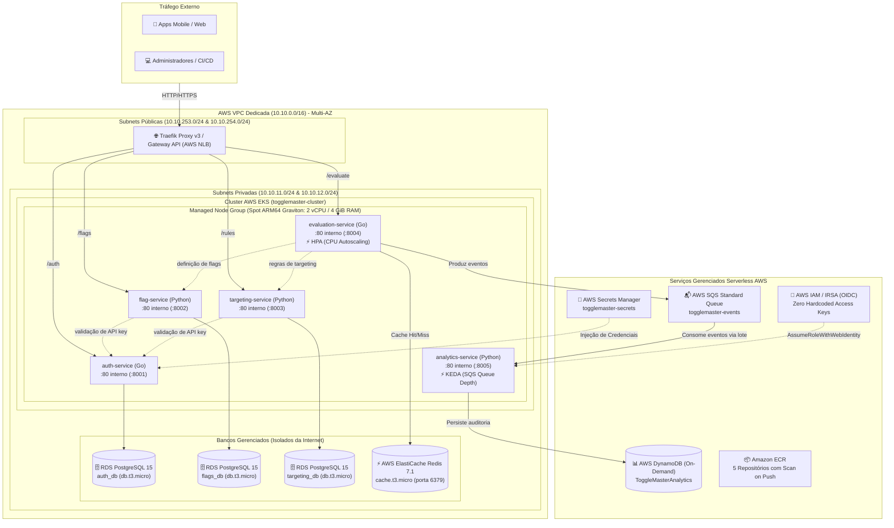
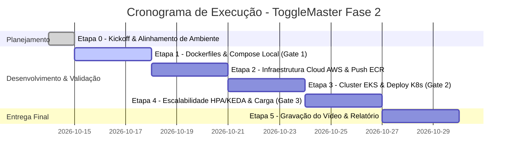

# ToggleMaster - Ecossistema Distribuído de Feature Flags

> **FIAP - Pós-Graduação em DevOps & Cloud Architecture**  
> **Tech Challenge - Fase 2**

---

## 📖 Sobre o Projeto

O **ToggleMaster** é uma plataforma corporativa de gerenciamento de **Feature Flags** de alta performance e resiliência.

Após a validação do MVP monolítico na Fase 1 pela diretoria da _DevOps Solutions Inc._, a demanda aumentou consideravelmente e a arquitetura começou a apresentar gargalos sob tráfego concorrente. Na **Fase 2**, o sistema foi inteiramente reescrito e desacoplado como um **ecossistema de 5 microsserviços distribuídos**, conteinerizados com Docker, orquestrados via **Kubernetes (AWS EKS)** e integrados a bancos relacionais, caches em memória, filas de mensageria assíncronas e bancos NoSQL gerenciados na nuvem.

---

## 🏛️ Arquitetura da Solução

A infraestrutura na nuvem AWS adota o princípio de privilégio mínimo e isolamento de rede Multi-AZ:



### Especificação dos Recursos de Infraestrutura Cloud AWS

1. **Topologia de Rede (Amazon VPC Multi-AZ):**
   - **VPC Dedicada:** CIDR `10.10.0.0/16` distribuída em duas Zonas de Disponibilidade (`us-east-1a` e `us-east-1b`).
   - **Subnets Públicas:** `10.10.253.0/24` e `10.10.254.0/24`, conectadas ao Internet Gateway para provisionamento do AWS Network Load Balancer (NLB) e Traefik Controller.
   - **Subnets Privadas:** `10.10.11.0/24` e `10.10.12.0/24`, onde residem os nós de processamento do EKS, os 3 bancos relacionais RDS e o cache ElastiCache Redis, sem qualquer exposição direta à Internet pública.

2. **Cluster Kubernetes Gerenciado (Amazon EKS):**
   - **Cluster EKS:** `togglemaster-cluster` com endpoints de API privado e público restrito a IPs autorizados (`public_access_cidrs`).
   - **Managed Node Group:** `togglemaster-nodes` alocado exclusivamente nas subnets privadas.
   - **Modelo de Instâncias e Custo:** Instâncias EC2 **ARM64 (AWS Graviton)** em capacidade `SPOT` selecionadas dinamicamente por requisito de hardware (`2 vCPUs` e `4 GiB RAM` via `aws_ec2_instance_types` — ex.: `t4g.medium`, `c6g.large`, `c7g.large`), combinando a estratégia `price-capacity-optimized` do EKS com dimensionamento automático (mínimo de 2 nós, desejado de 3 nós e máximo de 4 nós).
   - **Segurança de Instância (IMDSv2):** Launch Template com `http_tokens = required` e `http_put_response_hop_limit = 2`, permitindo que os pods utilizem credenciais temporárias do IAM de forma segura.
   - **Controle de Acesso EKS:** Modo de autenticação `API_AND_CONFIG_MAP` com EKS Access Entries mapeadas para `AmazonEKSClusterAdminPolicy`.

3. **Segurança, Identidade e Segredos:**
   - **IRSA (IAM Roles for Service Accounts):** Provedor OpenID Connect (OIDC) federado com o cluster EKS. Permissões granulares de IAM mapeadas diretamente para as Service Accounts do Kubernetes (`togglemaster-sa`, `keda-operator`), eliminando completamente credenciais estáticas de longa duração (_Zero Access Keys_).
   - **AWS Secrets Manager:** Gerenciamento centralizado e criptografado de credenciais (`togglemaster-secrets`).
   - **Segurança em Camadas (Security Groups):**
     - `eks-nodes-sg`: Tráfego interno irrestrito entre nós/pods, portas HTTP (80) e HTTPS (443) a partir do Load Balancer e range NodePort (`30000-32767`) restrito ao CIDR da VPC.
     - `rds-sg`: Porta 5432 liberada exclusivamente a partir do `eks-nodes-sg` e da rede interna da VPC.
     - `redis-sg`: Porta 6379 liberada exclusivamente a partir do `eks-nodes-sg` e da rede interna da VPC.

4. **Registro de Contêineres (Amazon ECR):**
   - 5 Repositórios privados com prefixo `togglemaster/` (`auth-service`, `flag-service`, `targeting-service`, `evaluation-service`, `analytics-service`).
   - Verificação de segurança automatizada ativa (`scan_on_push = true`) e proteção de integridade com tags mutáveis versionadas.

5. **Camada de Dados e Mensageria Gerenciada:**
   - **RDS PostgreSQL 15 (3 Instâncias Independentes):** Isolamento estrito de dados por domínio:
     - `togglemaster-staging-auth-db` (Database: `auth_db`) para o `auth-service`.
     - `togglemaster-staging-flags-db` (Database: `flags_db`) para o `flag-service`.
     - `togglemaster-staging-targeting-db` (Database: `targeting_db`) para o `targeting-service`.
     - Executando em `db.t3.micro`, armazenamento GP2 de 20GB, alocadas no DB Subnet Group privado e sem acesso público.
   - **AWS ElastiCache for Redis 7.1:** Cluster standalone (`cache.t3.micro`, porta 6379) em Subnet Group privada para servir o hot path do `evaluation-service` com latência sub-milissegundo.
   - **AWS SQS:** Fila standard `togglemaster-events` (timeout de visibilidade de 30s, retenção de mensagens de 24 horas / 86400s) para desacoplamento assíncrono entre a avaliação e a auditoria.
   - **AWS DynamoDB:** Tabela `ToggleMasterAnalytics` em modo Serverless sob demanda (`PAY_PER_REQUEST`), com Partition Key `event_id` (String), garantindo escalabilidade de escrita ilimitada sem provisionamento manual de capacidade.
   - **Governança de Custos (AWS Budgets):** Monitoramento contínuo de custos e limites de faturamento na nuvem.

---

## 🧩 Matriz dos Microsserviços e Padronização de Portas

> [!NOTE]
> **Padronização de Portas:** Todas as aplicações escutam **internamente na porta 80** (`containerPort: 80`, `ENV PORT=80`). No ambiente local (`docker-compose.yml`), são mapeadas para as portas **8001 a 8005** no host para permitir chamadas via browser, curl ou Postman. No Kubernetes, o Traefik Controller (operando em modo híbrido com Gateway API HTTPRoute e Ingress padrão) direciona as rotas para os Services ClusterIP na porta 80.

| Microsserviço                                      | Linguagem            | Datastore / Broker          | Porta Interna | Porta Externa (Host/Compose) | Responsabilidade Central                                                                                   |
| :------------------------------------------------- | :------------------- | :-------------------------- | :-----------: | :--------------------------: | :--------------------------------------------------------------------------------------------------------- |
| [**`auth-service`**](app/auth-service)             | Go 1.21+             | PostgreSQL (`auth_db`)      |    **80**     |             8001             | Autenticação, emissão e validação de chaves de API (`api_keys`).                                           |
| [**`flag-service`**](app/flag-service)             | Python 3.11 / Flask  | PostgreSQL (`flags_db`)     |    **80**     |             8002             | CRUD de Feature Flags (`name`, `is_enabled`, `description`).                                               |
| [**`targeting-service`**](app/targeting-service)   | Python 3.11 / Flask  | PostgreSQL (`targeting_db`) |    **80**     |             8003             | Regras complexas de segmentação (rollout percentual, listas de usuários).                                  |
| [**`evaluation-service`**](app/evaluation-service) | Go 1.21+             | Redis + AWS SQS             |    **80**     |             8004             | **Hot path** de alta performance. Avalia se a flag está ativa via cache Redis. Despacha evento para o SQS. |
| [**`analytics-service`**](app/analytics-service)   | Python 3.11 / Worker | AWS SQS + DynamoDB          |    **80**     |             8005             | Worker assíncrono que consome mensagens da fila SQS e persiste na tabela NoSQL. Porta 80 para `/health`.   |

---

## 🗄️ Comparativo dos 3 Data Stores

A arquitetura utiliza três tecnologias de armazenamento complementares, cada uma selecionada para o seu padrão de acesso ideal:

1. **RDS PostgreSQL (Relacional / ACID):**
   - _Propósito:_ Dados transacionais cadastrais (`auth`, `flags` e `targeting`).
   - _Justificativa:_ Exige consistência estrita (ACID), integridade referencial por foreign keys e transações seguras para criação de regras, flags e chaves de API. O volume de escrita é moderado e a criticidade de consistência é máxima.
2. **ElastiCache Redis (In-Memory Key-Value / Sub-milissegundo):**
   - _Propósito:_ Hot path de alta performance (`evaluation-service`).
   - _Justificativa:_ Atende a consultas em sub-milissegundos diretamente da memória RAM com expiração controlada via TTL (Time To Live), suportando dezenas de milhares de requisições por segundo e eliminando overhead de queries relacionais.
3. **AWS DynamoDB (NoSQL Distribuído / Alta Vazão de Escrita):**
   - _Propósito:_ Ingestão massiva de telemetria e histórico de auditoria (`analytics-service`).
   - _Justificativa:_ Banco serverless horizontalmente distribuído, operando em modo sob demanda (`PAY_PER_REQUEST`). Suporta gravações volumosas e contínuas sem risco de lock de tabelas, degradação de leitura ou necessidade de provisionamento prévio de throughput.

---

## 📅 Cronograma de Execução por Etapas (Timeline Sugerida)

Cronograma estruturado para execução em equipe com prazos, responsáveis e critérios de aceite (**Definition of Done**):



|    Etapa    |   Período    | Foco Técnico                                                                                                                                                                                            | Responsáveis                        | Critério de Aceite (Definition of Done)                                                                                                                      |
| :---------: | :----------: | :------------------------------------------------------------------------------------------------------------------------------------------------------------------------------------------------------ | :---------------------------------- | :----------------------------------------------------------------------------------------------------------------------------------------------------------- |
| **Etapa 0** |    Dia 1     | **Kickoff & Ambiente Cloud:** Definição da conta (AWS Academy com `LabRole` vs Conta Pessoal) e divisão de papéis da equipe.                                                                            | Toda a Equipe                       | Conta AWS acessível por todos e papéis definidos.                                                                                                            |
| **Etapa 1** |  Dias 2 a 4  | **Conteinerização Local:** 5 Dockerfiles multi-stage (Go/Python na porta 80) e `docker-compose.yml` (9 contêineres: 5 apps + 4 DBs locais).                                                             | Integrante 1 (Lead) + Integrante 2  | Execução com 100% de sucesso do script [`validate-local.sh`](scripts/validate-local.sh) ou [`app/scripts/validate-local.sh`](app/scripts/validate-local.sh). |
| **Etapa 2** |  Dias 5 a 7  | **Infraestrutura AWS:** Provisionamento de 5x ECR, 3x RDS PostgreSQL, 1x ElastiCache Redis, 1x SQS Standard e 1x tabela DynamoDB. Build e push das imagens.                                             | Integrante 2 (Lead) + Integrante 3  | 5 imagens taggeadas no ECR e planilha de connection strings preenchida.                                                                                      |
| **Etapa 3** | Dias 8 a 10  | **Cluster EKS & Kubernetes:** Criação do cluster EKS e Node Groups (com `LabRole`), instalação de Metrics Server e Traefik Controller (Gateway API + Ingress), criação dos manifestos YAML na porta 80. | Integrante 3 (Lead) + Integrante 1  | Execução aprovada do script [`validate-k8s.sh`](scripts/validate-k8s.sh) e curl no Load Balancer.                                                            |
| **Etapa 4** | Dias 11 a 13 | **Escalabilidade & Testes de Carga:** Configuração de HPA (CPU) e KEDA, teste de estresse com `hey` no evaluation e lote SQS no analytics.                                                              | Integrante 4 (Lead) + Integrante 3  | Execução aprovada do script [`validate-scalability.sh`](scripts/validate-scalability.sh) e script de carga [`load-test.sh`](scripts/load-test.sh).           |
| **Etapa 5** | Dias 14 a 16 | **Vídeo & Documentação Final:** Gravação do vídeo de até 20 min com o roteiro da banca, elaboração do relatório em PDF/TXT e badges do Google Cloud (+10 bônus).                                        | Integrante 4 (Lead) + Toda a Equipe | Vídeo publicado no YouTube/Drive e relatório submetido no portal acadêmico.                                                                                  |

---

## 🚦 Quality Gates & Validação Automática

O projeto disponibiliza **scripts de auditoria automatizada** para validar a conformidade de cada entrega:

1. **Gate 1 - Validação do Ambiente Local:**

   Valida se todos os 9 contêineres do `docker-compose.yml` estão ativos, testa `/health` nas portas 8001 a 8005, emite chave de API no `auth-service`, cria flag, cria regra de targeting e valida a resposta de `/evaluate`:

   ```bash
   # Subir os containers
   docker compose -f ./app/docker-compose.yml up -d

   # Validar
   ./app/scripts/validate-local.sh

   # Parar e remover os containers
   docker compose -f ./app/docker-compose.yml down --rmi all -v --remove-orphans
   ```

2. **Gate 2 - Validação de Manifestos no Cluster Kubernetes:**

   Audita a existência do namespace, a declaração obrigatória de `resources.requests` e `resources.limits` em todos os pods, as probes de `livenessProbe`/`readinessProbe` na porta 80, Services ClusterIP na porta 80 e a saúde do Ingress Load Balancer:

   ```bash
   ./scripts/validate-k8s.sh togglemaster
   ```

3. **Gate 3 - Validação de Escalabilidade e Telemetria:**

   Valida o funcionamento do Metrics Server no EKS, a presença e o status dos HPAs (`evaluation-service`), a conectividade com a fila SQS (`togglemaster-events`) e a persistência de registros na tabela DynamoDB (`ToggleMasterAnalytics`):

   ```bash
   ./scripts/validate-scalability.sh togglemaster
   ```

4. **Testes de Carga e Estresse Automatizados (HPA CPU + KEDA SQS):**

   Executa a bateria completa de testes de estresse: carga de CPU via ferramenta `hey` no `evaluation-service` para forçar o autoscaling do HPA e injeção em lote de 200 mensagens na fila SQS para acionamento do KEDA e gravação no DynamoDB:

   ```bash
   ./scripts/load-test.sh --all
   ```

5. **Testes de Integração de Aplicação:**

   Executa o fluxo fim a fim das rotas HTTP dos microsserviços:

   ```bash
   ./app/scripts/test-app.sh
   ```

---

## 👥 Papéis e Responsabilidades da Equipe

| Papel no Projeto                     | Responsabilidades Centrais                                                                                                                                   |
| :----------------------------------- | :----------------------------------------------------------------------------------------------------------------------------------------------------------- |
| 🐳 **Docker & Ambiente Local Lead**  | Construção dos 5 Dockerfiles multi-stage (porta 80), configuração do `docker-compose.yml` (9 contêineres) e scripts SQL de seed.                             |
| ☁️ **Cloud & Infrastructure Lead**   | Provisionamento dos repositórios ECR, bancos RDS PostgreSQL, cluster ElastiCache Redis, fila SQS, tabela DynamoDB e roles de acesso.                         |
| ☸️ **Kubernetes & Networking Lead**  | Deploy do cluster EKS, Node Groups, Traefik Controller v3 (Gateway API + Ingress), Metrics Server e manifestos (Deployments, Services, ConfigMaps, Secrets). |
| ⚡ **SRE, Escalabilidade & QA Lead** | Configuração do HPA e KEDA, execução dos testes de carga (`hey`), validação de telemetria no DynamoDB e condução da gravação do vídeo.                       |

---

## 👥 Integrantes do Grupo

| Nome do Aluno                     |     RM     | Google Skill Badge                                                             |
| :-------------------------------- | :--------: | :----------------------------------------------------------------------------- |
| Kayky Santos da Cunha Couto       |            | https://www.skills.google/public_profiles/01c320b7-257c-4aff-a654-0b39b2758c63 |
| Lúcio Alves Toledo                |  rm375870  | https://www.skills.google/public_profiles/f6d7f1e2-4237-4277-b1ab-9f595b94ea0a |
| Bruno Alexandre Manoel de Freitas | _RM123456_ | `@usuario_3`                                                                   |
| Beatriz da Silva Castro           | _RM123456_ | `@usuario_4`                                                                   |

---
